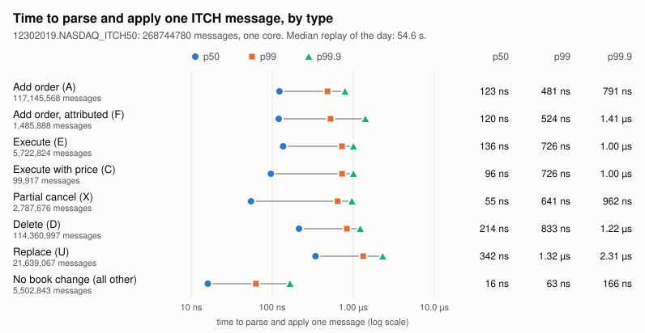

# Agora

**A limit order book in Rust that rebuilds a full Nasdaq trading day from the exchange's own messages.**

## Result

The Nasdaq TotalView-ITCH 5.0 sample for 30 December 2019 holds 268,744,780 messages. Agora parses all of them and rebuilds every book, 8,906 stocks, in 54.6 seconds on one core: 4.9 million messages a second, 203 ns a message. Reading and parsing alone take 4.9 of those seconds.

The day replays without one inconsistency. No message names an unknown order, none takes more shares than its order has left, and the 47,597,537,971 shares added balance exactly against the shares executed, cancelled, deleted and replaced, with nothing left resting at the close. The rebuilt books were crossed 30 times, across 13 stocks, and every time the stock was halted or paused. No book was crossed while its stock was trading.



Median time to parse and apply one message is 150 ns, the 99th percentile 855 ns, the 99.9th 1.4 µs. Replace is the slowest type because it removes one order and adds another.

Two things did not come out as the design said they would. The book does cross, during halts. And 10,565 of the 5,722,824 plain executions (0.185%) took an order that was at the best price but was not the oldest one there, which I could not explain. Details are under "What did not match" below.

## Reproduce

```
scripts/fetch_data.sh        # 3.5 GB download into data/, once
scripts/reproduce.sh         # decompresses to 8.3 GB, then rebuilds results/ (about 6 minutes)
scripts/reproduce.sh --fast  # no download: the committed synthetic stream, a few seconds
```

On Windows use `scripts\fetch_data.ps1` and `scripts\reproduce.ps1`. You need stable Rust (`rust-toolchain.toml` pins 1.97.0) and `curl`. The full run needs about 12 GB of free disk.

The counts and the invariant report come out the same on every run. The timings do not: they depend on the machine and on what else it is doing.

## The question

An exchange is a data structure with rules. How fast can you run it, and can you prove you ran it correctly against a real day of messages?

## What was built

- A price-time-priority limit order book (`src/book.rs`). Orders sit in a slab, linked into one first-in-first-out queue per price. Each side keeps its price levels in a sorted vector with the best price last.
- A matching engine on top of it (`src/engine.rs`): submit, partial cancel, delete, replace. An incoming order trades against the oldest order at the best opposite price first.
- A parser and encoder for all 23 message types of Nasdaq TotalView-ITCH 5.0 (`src/itch.rs`), and a reader for the length-prefixed sample files, plain or gzipped.
- A replay (`src/replay.rs`) that applies add, execute, cancel, delete and replace messages to one book per stock.
- An invariant checker inside the replay. After every book update it tests whether that book is crossed. For every execution it records whether the order was the oldest at the best price. At the end it audits every queue against its level totals and balances the share ledger.
- A benchmark: throughput over the whole day, and latency percentiles per message type from the CPU's time-stamp counter (`src/hist.rs`). Criterion micro-benchmarks are in `benches/`.
- A seeded generator of valid ITCH streams (`src/synth.rs`). It drives the matching engine with random orders and writes what an exchange would publish, so replaying its output must rebuild the engine's books exactly.

The command is `agora`: `cargo run --release -- replay <file> --check` replays any ITCH 5.0 file and prints the invariant summary.

## Numbers

All from `results/`, written by `scripts/reproduce`.

| | |
|---|---:|
| Messages in the day | 268,744,780 |
| Decompressed size | 8,251,407,909 bytes |
| Stocks in the directory | 8,906 |
| Orders added | 140,270,523 |
| Most orders resting at once | 1,924,078 |
| Replay, median of three runs | 54.6 s |
| Replay, the three runs | 54.6, 54.9, 49.1 s |
| Replay with every check on | 52.6 s |
| Read and parse only | 4.9 s |

Add Order is 43.6% of the messages, Order Delete 42.6% and Order Replace 8.1%. Executions are 2.2%. Only 1.5% of the shares added during the day were ever executed.

Latency, time to parse and apply one message:

| Messages | p50 | p99 | p99.9 | p99.99 |
|---|---:|---:|---:|---:|
| Add Order (A) | 123 ns | 481 ns | 791 ns | 5.8 µs |
| Order Executed (E) | 136 ns | 726 ns | 1.0 µs | 7.4 µs |
| Order Cancel (X) | 55 ns | 641 ns | 962 ns | 5.6 µs |
| Order Delete (D) | 214 ns | 833 ns | 1.2 µs | 7.9 µs |
| Order Replace (U) | 342 ns | 1.3 µs | 2.3 µs | 11.3 µs |
| All messages | 150 ns | 855 ns | 1.4 µs | 7.4 µs |

The slowest single message took 21.6 ms. An empty measurement costs about 5 ns and is not subtracted. Every type is in `results/latency_percentiles.csv`.

## What did not match

Full detail and the claim-by-claim table are in `PAPER.md`.

- The book crosses during halts. The design promised a best bid and offer that never cross. On this day 8,580 of 284,881,004 book updates left a book crossed, in 30 episodes. All 30 began while the stock's trading state was halted or paused, when Nasdaq accepts orders without matching them. The claim that holds is narrower: never crossed while trading. `results/crossed_examples.csv` lists the episodes.
- Price-time priority holds for 99.815% of executions. Every one of the 5,722,824 Order Executed messages hit an order at the best price, and 5,712,259 hit the oldest order there. The other 10,565 had an older order ahead of them in the rebuilt queue. All of them happened in regular hours with the stock trading. I do not know the cause.
- The specification does not say where a replaced order goes in the queue. Agora puts it at the back. The other reading I tried, keeping the place when the price is unchanged and the size is not larger, gave 11,153 out-of-order executions against 10,565, so the back of the queue fits this day better.
- The golden test on the first million real messages exists and passes on this machine, but it is skipped where the data file is absent, CI included. CI runs the same test on synthetic streams.

## Sources

- Nasdaq, *Nasdaq TotalView-ITCH 5.0* specification, fetched 2026-11-23 from nasdaqtrader.com. `PAPER.md` records every message layout with its section number.

The file framing (a two-byte length before each message) is not in that specification. It was confirmed from the file itself.

## Data

Nasdaq publishes full-day ITCH 5.0 sample files, free and without a login, at emi.nasdaq.com/ITCH. This project uses `12302019.NASDAQ_ITCH50.gz`, the smallest full day there (3.5 GB). The directory states no licence, so no file from it is committed here, and neither is anything derived from it beyond counts, timings, one digest and the 13 symbols and 30 quotes in the crossed-book tables.

Nasdaq's checksum file for this day returns 404. The fetch script checks the size and the MD5 of the copy used here, which is weaker than the publisher's own checksum.

The synthetic stream in `tests/data/` is generated by this code and is covered by the MIT licence.

## How it is tested

74 tests. `cargo test` runs all of them in a few seconds.

- One test per message type (`tests/messages.rs`). Each builds a message by hand at the offsets in the specification, parses it, and checks that the encoder gives the same bytes back.
- Property tests (`tests/properties.rs`). The matching engine is compared, fill by fill, with a brute-force model over random order sequences; after every step the book is not crossed or locked, the queues pass a full audit, and shares in equal shares out. The parser round-trips every message in both directions and does not panic on arbitrary bytes. Replaying a generated stream rebuilds the generator's books for any seed. Replaying arbitrary, mostly invalid order messages still balances the ledger.
- Golden tests (`tests/golden.rs`). The committed synthetic stream, one million generated messages, and the first million messages of the real day each have a pinned digest of the full book state.
- A test runs the smoke reproduce twice and compares both outputs with the committed `results/smoke/`.

CI runs `cargo fmt --check`, `cargo clippy -- -D warnings`, `cargo test`, the smoke replay, and a check that the smoke tables did not change.

## Layout

```
src/               the order book, the matching engine, the parser, the replay tool
tests/             unit, property (proptest) and golden tests; a small synthetic stream
benches/           throughput and book micro-benchmarks (criterion)
scripts/           fetch one sample day; reproduce the results
results/           committed tables and the chart
PAPER.md           the specification and what was checked against it
```

## Roadmap

- [x] Project skeleton, CI, and the reproduce command
- [x] A price-time-priority limit order book: add, cancel, replace, execute
- [x] A parser for Nasdaq TotalView-ITCH 5.0
- [x] A replay tool that rebuilds the book for every symbol across one full trading day
- [x] A benchmark: messages per second, and latency percentiles per message type
- [x] A checker that the rebuilt best bid and offer never cross and that volume is conserved
- [x] `PAPER.md` comparison with the sources
- [x] Results and limits written up at the top of this file

## Limits

- One day. Nothing here says how the numbers move on a busier day; the largest sample in the directory is five times this one.
- The timings are from one desktop CPU (Intel Core i9-13900K, Windows 11) with other programs running, on an unpinned thread. Two full runs gave medians of 48.2 s and 54.6 s. They say how this code compares with itself and should not be compared with a production engine's figures.
- The file is replayed from the operating system's cache, one message at a time. There is no network, no packet handling and no gap recovery.
- Nothing was optimised after the first working version. A profile would likely point at the order-reference hash map, which is touched by every book message.
- The rebuilt books are checked against themselves. There is no public Nasdaq snapshot to compare them with.
- Five message types (MWCB Status, Operational Halt, Broken Trade, RPII and DLCR Price Discovery) do not occur on this day, so their parsers have only been run on hand-built and generated messages.
- Hidden orders never appear in the feed, so the book is the displayed book only. Crosses are counted from their trade messages and are not simulated.
- The matching engine handles limit orders only: no market orders, no time-in-force, no hidden or pegged orders, no auctions.
- It replays an exchange's book. It is not connected to anything and sends no orders.
- This is research code. It is not investment advice and it does not trade.

## The name

The agora was the marketplace: where buyers and sellers met and a price was made.

## Licence

MIT. See `LICENSE`.
